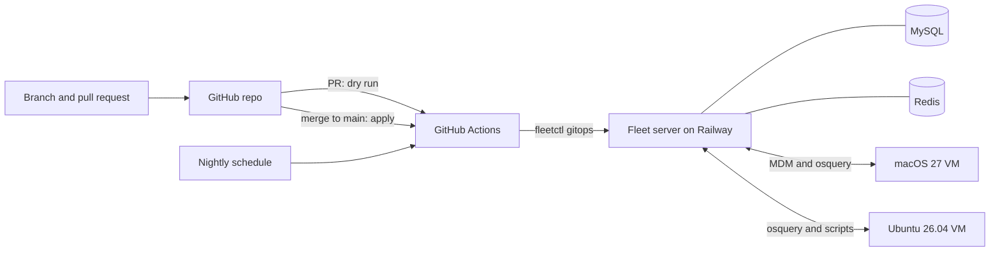

# Fleet GitOps Lab

A self-hosted [Fleet](https://fleetdm.com) lab where device management configuration is managed as code. I built it to practice the change discipline used for production fleets: every change is reviewed, validated automatically, applied automatically, and corrected if it drifts.

This is a home lab. It manages one macOS virtual machine and one Ubuntu Server virtual machine. The limits are listed below.

## Architecture

- **Fleet server:** `fleetdm/fleet` container on Railway, pinned to an exact version.
- **MySQL and Redis:** Railway services, pinned to exact versions, reachable only over Railway's private network. No public access.
- **Apple MDM:** enabled with an APNs certificate issued to a personal Apple ID.
- **macOS host:** one macOS 27 virtual machine running fleetd, used as the canary.
- **Linux host:** one Ubuntu Server 26.04 LTS virtual machine (ARM64, UTM) running fleetd with scripts enabled. LUKS full-disk encryption, which Fleet reports as on. Linux has no MDM channel, so every setting is a policy that checks state plus a script that fixes it.
- **Image auto-updates are off for Fleet, MySQL, and Redis.** A version change is a deliberate change.

## How a change ships

1. Create a branch and edit the YAML or a file under `lib/`.
2. Open a pull request. The description states the expected end state before anything changes.
3. CI runs `fleetctl gitops --dry-run`. Pull requests never apply.
4. Merge to main. CI runs the dry run again, then applies.
5. Verify the result on the server or the device, not just the green check.
6. A nightly scheduled run re-applies the repo, so changes made outside Git are overwritten within a day.

The Fleet server URL, API token, and enroll secret live in GitHub Actions secrets. The YAML only references them as environment variables.

## Guardrails

**Branch protection on main**

- Pull request required to merge.
- The `fleet-gitops` CI check must pass.
- Force pushes blocked. Branch deletion blocked.
- Bypass list empty.

Tested: a direct push to main is rejected with `push declined due to repository rule violations`.

**CI fails closed**

Fleet's starter GitHub Action installs a `fleetctl` version matched to the server. If it could not read the server version, it fell back to a hardcoded default version. If installing the matched version failed, it fell back to `fleetctl@latest`. Either way the job continued and could still pass.

I removed both fallbacks in [`.github/gitops-action/action.yml`](.github/gitops-action/action.yml). Now, if the server version can't be read or the matching `fleetctl` can't be installed, the job stops. For a tool that pushes configuration to every managed device, a run with an unverified tool version should fail, not proceed.

**Agent packages can't be committed**

`fleetctl package` writes the agent installer into the current directory, and that installer contains the enroll secret. While enrolling the Linux host, one landed in this repo's folder. It was moved out before any commit, and [pull request #5](https://github.com/judeglenn/fleet-lab-gitops/pull/5) added a `.gitignore` for `.deb`, `.rpm`, `.pkg`, and `.msi` files. Tested by copying a package back into the folder: `git status` stayed clean.

## Example changes

**Disable Fleet usage analytics** ([pull request #1](https://github.com/judeglenn/fleet-lab-gitops/pull/1)).

- Change: `enable_analytics: true` to `false` in `default.yml`.
- Expected end state written in the pull request before merging.
- Pull request run: dry run only. Merge run: applied.
- Verified afterward in Fleet under Settings, Organization settings, Usage statistics: unchecked. My predicted location in the pull request was wrong (I expected Advanced options).

**Enforce a firewall on the Linux host** ([pull request #6](https://github.com/judeglenn/fleet-lab-gitops/pull/6)).

- Change: a policy, **Linux - Firewall (ufw) enabled**, that reads `/etc/ufw/ufw.conf` through Fleet's `file_lines` table, plus `linux-ufw-enable.sh`, which allows SSH, denies other inbound traffic, and enables ufw.
- Before merging: ran the policy query live on the host. No rows, as expected with ufw disabled. The dry run listed one new policy and one new script.
- After the apply: the policy showed **Fail** on the host. Ran the script from the host's Actions menu. Output showed `Status: active` with `22/tcp ALLOW IN`.
- Verified: SSH from the Mac still connected through the firewall, the same live query returned one row, and after a refetch the policy showed **Pass**.
- What I learned: the policy did not update when the script finished. Fleet re-checks policies on its own schedule, so a refetch was needed to see the new result.

**Harden SSH on the Linux host** ([pull request #8](https://github.com/judeglenn/fleet-lab-gitops/pull/8)).

- Change: a policy, **Linux - SSH hardened (no root login, no passwords)**, plus `linux-ssh-harden.sh`, which writes `/etc/ssh/sshd_config.d/00-fleet-hardening.conf`, validates it with `sshd -t`, and reloads ssh. sshd keeps the first value it reads for each setting, so the `00-` name makes this file win over later drop-ins such as `50-cloud-init.conf`.
- Lockout guard: the script refuses to run unless a regular user has an SSH key in `authorized_keys`, and rolls back if `sshd -t` rejects the new file.
- Before merging: the policy query errored on the host with `error generating table: file does not exist`. `file_lines` errors on a missing file instead of returning no rows, and an errored policy reports no result instead of a failure. A host that was never hardened would never have shown as failing. Fixed by checking the `file` table first and reading lines only when the file exists. Re-ran live: no rows, no error.
- After the apply: the policy showed **Fail**. Ran the script from the host's Actions menu. Output listed `labuser` as having a key, then `permitrootlogin no`, `passwordauthentication no`, and `kbdinteractiveauthentication no`.
- Verified from the Mac: forcing password authentication was refused with `Permission denied (publickey)`, key login still worked, and after a refetch the policy showed **Pass**.
- What I learned: a policy is only as good as its failure path. Test the query against the broken state, not just the fixed one.

**Turn on automatic security updates on the Linux host** ([pull request #9](https://github.com/judeglenn/fleet-lab-gitops/pull/9)).

- Change: a policy, **Linux - Automatic security updates enabled**, that checks the `unattended-upgrades` package is installed and that `20auto-upgrades` enables both the daily package list refresh and unattended upgrades, plus `linux-unattended-upgrades-enable.sh` to install the package, write the file, and enable the apt timers. The query uses the same `file` table check from pull request #8.
- Before merging: the live query returned one row. Ubuntu Server ships with this on, so the policy started out passing.
- Drift test: changed `Unattended-Upgrade` from `"1"` to `"0"` on the host. The live query returned no rows. Ran the script from the host's Actions menu and it completed successfully.
- What I learned: a control that already passes still needs proof that it catches drift. Breaking it on purpose is the only way to see the failure path.

## Limits

- **Scale.** Two VMs. This shows the workflow, not fleet-scale operation.
- **Solo review.** Pull requests require zero approvals, because GitHub doesn't let you approve your own. Branch protection still blocks direct pushes, and CI still gates every merge.
- **Admin CI token.** On Fleet's free tier, the CI user has to be a global admin. A narrower GitOps role is a Premium feature. The token lives only in GitHub secrets.
- **Console not locked.** Fleet's GitOps-only console mode is Premium. Changes made in the console are overwritten by the next apply, but they are not blocked.
- **Drift is corrected, not detected.** Fleet's dry-run output lists every section it would apply, including "would've updated 4 labels" on a configuration exported from the live server. It doesn't show what actually differs, so the nightly run fixes drift without reporting it.
- **Remediation is manual.** Running a script automatically when a policy fails is a Premium feature, and so is targeting a policy by label. On the free tier, the Linux policy detects and flags, a person runs the fix from Fleet, and the policy is scoped by platform rather than label. Scripts are also listed for every host, macOS included, so Linux scripts carry a `linux-` prefix.
- **No macOS profile enforced on a device yet.** A firewall profile is defined in this repo and listed in Fleet, but it has not been delivered to the macOS VM. See the open issue below. The three Linux policies (firewall, SSH, automatic updates) are enforced and verified.

## Open issue: profile delivery

The firewall profile ([pull request #2](https://github.com/judeglenn/fleet-lab-gitops/pull/2)) merged and appeared in Fleet under Controls, OS settings, but never reached the VM. Fleet's console showed the VM's MDM status as "On (manual)."

What I checked, in order:

1. **Device, via osquery.** A live query of `managed_policies` for firewall settings returned no rows. The Mac never received the profile.
2. **MDM commands.** `fleetctl get mdm-commands` reported that no MDM commands had ever been run on this host.
3. **Server state.** `fleetctl get host` showed `enrollment_status: On (manual)` alongside `connected_to_fleet: false`.
4. **Server logs.** The Apple profile manager ran every cycle and completed without errors, yet no MDM command was ever created for this host.
5. **HTTP logs.** Every MDM check-in request from the VM to `/mdm/apple/mdm` returned status 200.
6. **MDM database.** `nano_devices` had one row. `nano_enrollments` was empty. In Apple's MDM check-in flow, the enrollment record comes from the TokenUpdate message, which carries the device's push token.
7. **Device logs.** `mdmclient` repeatedly logged `Connection Invalid for service com.apple.apsd`. The push daemon (`apsd`) itself was running.

Ruled out by evidence:

- **Enrollment order.** Re-enrolling the VM with fleetd already installed did not change it. `connected_to_fleet` stayed `false` and `nano_enrollments` stayed empty.
- **The wrong database.** The `hosts` table held the expected host record.
- **The hosting proxy stripping device identity.** The device record in `nano_devices` shows the identity check-in was processed.
- **A failing profile manager.** It ran cleanly every cycle.

**Current status: traced to the push token step (TokenUpdate) never producing an enrollment, with `mdmclient` unable to reach `apsd` on the VM. The cause is not yet confirmed.** The confirmation test is enrolling a physical Mac the same way.

Lessons:

- The console showed the device's own MDM status. The server's `connected_to_fleet` field said otherwise.
- A 200 response means the request was received, not that it was processed.
- After MDM enrollment, fleetd did not install itself, so I installed it by hand. Fleet also never sent this host any MDM command, so the missing install may have been an early sign of the same problem.

## Next

- Enroll a physical Mac to confirm or rule out the push token cause.
- Add drift detection: export the live configuration nightly, diff it against the repo, and fail with the diff before re-applying.
- Roll back a deliberately bad change by reverting its pull request, and verify removal on the device.
- Bump `actions/checkout` off Node 20, which GitHub Actions now warns about.
- Separate staging and production instances, with changes promoted between them.
